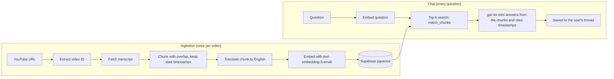

# YouTube RAG Chat

Paste a YouTube link, then ask questions about the video. Answers come only from what was said in it, with timestamps cited. Each user has their own account and can keep multiple saved conversations per video, switching between them like in ChatGPT.

Works with videos in any language, including Hinglish (Hindi with English technical terms), which is where most of the interesting engineering in this project came from (see [Challenges](#challenges-and-learnings)).

**Status:** working locally with a full evaluation pipeline. Deployment is planned (see [Deployment](#deployment)).

## Features

- **Chat with any captioned YouTube video:** grounded answers with timestamp citations; says so when the video doesn't cover something
- **Accounts and threads:** sign up / log in (Supabase Auth), multiple conversations per video, a sidebar of all your chats across videos, delete any thread
- **Any caption language:** uses whichever transcript the video has; chunks are translated to English before embedding so English questions retrieve reliably
- **Shared ingestion, private chats:** a video is processed once and shared by all users; conversations are per-user
- **Safe ingestion:** videos are `processing` / `ready` / `failed`; two users can't ingest the same video at once, and failed or abandoned ingestions are retried automatically
- **Evaluation pipeline:** separate retriever, generator and end-to-end evals with DeepEval, plus timestamp-based hit@k and MRR

## How it works



1. **Load:** the transcript is fetched with `youtube-transcript-api` (manual captions preferred over auto-generated).
2. **Chunk:** the transcript is split into overlapping word-based chunks. Every word keeps its own timestamp, so each chunk knows exactly when it starts.
3. **Translate and embed:** each chunk is translated to English (with a domain glossary), embedded, and stored with both the original and English text.
4. **Retrieve:** the question is embedded and matched against that video's chunks by cosine distance in pgvector.
5. **Generate:** the top chunks go to the LLM with the conversation history. It must answer only from them and cite timestamps.

## Tech stack

| Piece | Tool |
|---|---|
| Frontend | Streamlit |
| Auth | Supabase Auth |
| Database and vector search | Supabase (Postgres + pgvector) |
| Embeddings | OpenAI `text-embedding-3-small` |
| Translation and answers | OpenAI `gpt-4o-mini` |
| Transcripts | `youtube-transcript-api` |
| Evaluation | DeepEval (LLM-as-judge, `gpt-4o-mini` by default) |

No LangChain or other orchestration framework. The pipeline is a few plain functions, which made every bug in it directly debuggable.

## Project structure

```
.
├── App.py               # Streamlit app: auth, ingestion, chat threads
├── Auth.py              # Supabase Auth sign up / log in
├── Pipeline.py          # ingestion flow shared by the app and the CLI
├── Ingest.py            # admin CLI: ingest a video, or --force a rebuild
├── Transcript.py        # fetch captions in any language
├── Chunk.py             # word-based chunking that keeps start timestamps
├── Store.py             # translation, embeddings, retrieval, generation, threads, video status
├── Utils.py             # video-id parsing, title lookup
├── debug_retrieval.py   # inspect the top-k chunks and similarity for a question
├── schema.sql           # full database schema
├── eval_common.py       # shared eval helpers
├── eval_retriever.py    # retriever-only evaluation
├── eval_generator.py    # generator-only evaluation
├── eval_rag.py          # end-to-end evaluation
├── eval_failures.py     # list the worst-scoring questions from a results file
├── eval_diagnose.py     # split end-to-end failures into retrieval vs generation problems
├── golden_set.json      # evaluation questions with reference answers and timestamps
├── eval_results/        # saved eval runs (per-question scores and judge reasons)
├── requirements.txt
└── .env.example
```

## Setup

**Prerequisites:** Python 3.12, a Supabase project, an OpenAI API key.

```bash
git clone <your-repo-url>
cd <repo>
python -m venv venv
venv\Scripts\activate          # macOS/Linux: source venv/bin/activate
pip install -r requirements.txt
```

**1. Database.** In the Supabase SQL editor, run `schema.sql`.

**2. Auth.** Email sign-up is on by default. Supabase may require email confirmation before login. For local testing you can turn that off under Authentication, Providers, Email.

**3. Environment.** Copy `.env.example` to `.env` and fill in:

| Variable | Where to find it |
|---|---|
| `OPENAI_API_KEY` | platform.openai.com |
| `SUPABASE_URL` | Supabase, Project Settings, API |
| `SUPABASE_SERVICE_KEY` | same page, the **service_role** key (server-side only, never expose it) |
| `SUPABASE_ANON_KEY` | same page, the **anon public** key (used for login) |
| `EVAL_JUDGE_MODEL` | optional, defaults to `gpt-4o-mini` |

**4. Run.**

```bash
streamlit run App.py
```

Sign up, paste a YouTube URL in the sidebar, click **Ingest video**, then start a conversation.

### Admin CLI

```bash
python Ingest.py "<youtube-url>"            # ingest without the UI
python Ingest.py "<youtube-url>" --force    # wipe and rebuild a video from scratch
```

`--force` is deliberately not available in the app. Chunks are shared by every user of a video, so one user rebuilding it would break everyone else's chats. Use it after changing chunking or the translation prompt.

## Evaluation

The retriever, the generator and the whole pipeline are evaluated separately, so a low score points at the stage that caused it.

| Script | What it isolates | Metrics |
|---|---|---|
| `eval_retriever.py` | retrieval | contextual precision, recall, relevancy; hit@1/3/5 and MRR |
| `eval_generator.py` | generation, fed the golden context | faithfulness, answer relevancy, correctness |
| `eval_rag.py` | end to end, on real retrieved context | all of the above |

```bash
pip install deepeval
python eval_retriever.py --video VIDEO_ID --tag baseline
python eval_generator.py --tag baseline
python eval_rag.py --video VIDEO_ID --tag baseline
python eval_failures.py eval_results/rag_baseline.json "Correctness [GEval]"
python eval_diagnose.py eval_results/rag_baseline.json
```

Add `--limit 3` for a cheap dry run. Use `--tag` to label a run (for example `k3` or `chunk150`) so configurations can be compared. Each run saves per-question scores and the judge's reasoning to `eval_results/`.

**Golden set.** `golden_set.json` holds 38 questions written from a 46-minute Hindi/Hinglish LangChain tutorial. Each item has a question, a reference answer, the passage that contains it, and the seconds where the answer is spoken:

```json
{
  "question": "Which text splitter and settings does the speaker demonstrate?",
  "expected_output": "The RecursiveCharacterTextSplitter with a chunk size of 1,000 and a chunk overlap of 200.",
  "golden_context": ["[~14:47-15:46] The speaker says the transcript is split using ..."],
  "answer_ranges": [[887, 946]]
}
```

`answer_ranges` is what makes hit@k and MRR possible without an LLM judge: a chunk counts as a hit if its time span overlaps the range.

### Baseline results

Retriever, 38 questions, judge `gpt-4o-mini`:

| Metric | Mean | Pass rate (>= 0.7) |
|---|---|---|
| Contextual precision | 0.79 | 73.7% |
| Contextual recall | 0.84 | 71.1% |
| Contextual relevancy | 0.18 | 2.6% |

Recall and precision are solid for an untuned retriever. Relevancy is low by construction: each chunk is a minute or more of speech and the top 5 are sent, while the answer usually sits in a 20 to 60 second window. It is useful for comparing configurations, not against a fixed target. End-to-end (`eval_rag.py`), 38 questions, same judge:

| Metric | Mean | Pass rate (>= 0.7) |
|---|---|---|
| Contextual precision | 0.78 | 73.7% |
| Contextual recall | 0.86 | 76.3% |
| Contextual relevancy | 0.17 | 0.0% |
| Faithfulness | 0.81 | 71.1% |
| Answer relevancy | 0.85 | 81.6% |
| Correctness | 0.68 | 65.8% |

The retrieval scores match the retriever-only run within judge noise, as expected since retrieval is identical. Correctness is the weakest metric: about two thirds of answers match the reference answer. `eval_diagnose.py` splits the failures into retrieval misses and generation problems. The generator-only run (fed golden context) is saved in `eval_results/generator_baseline.json`.

**Reading the numbers honestly:** with 38 questions one question moves a pass rate by about 2.6 points; the judge itself varies by roughly 0.02 between identical runs; and a small golden set from a single video says little about other content.

## Design decisions

- **Shared chunks, private chats.** A video's chunks are public derived data, computed once and shared. Threads and messages are per-user, and every read or write checks ownership.
- **Atomic ingestion claim.** Inserting the `videos` row is the claim; only one insert can win. A heartbeat keeps long ingestions from looking crashed, and `failed` or stale `processing` videos are retaken automatically.
- **Timestamps at word level.** Chunk boundaries rarely align with caption lines, so every word carries its own timestamp and a chunk reports the exact start of its first word.
- **Evaluate stages separately.** The generator eval gets perfect context so retrieval can't affect it. The end-to-end eval gets real retrieval. The gap between them shows where quality is lost.

## Challenges and learnings

- **Hinglish transcripts broke retrieval.** Auto-captions transliterate English jargon into Devanagari ("text splitter" becomes "टेक्स्ट स्प्लिटर"). English questions matched poorly: the best similarity was about 0.28 and the right chunk wasn't in the top 10. Translating each chunk to English before embedding fixed the mismatch at its source.
- **The fix introduced new errors.** Translation turned "augmentation" into "argumentation", and some already-English chunks got translated into Hindi. A domain glossary and an explicit "output is always English, leave English unchanged" rule fixed both.
- **Timestamps were minutes off.** 500-word chunks span 3 to 4 minutes, so a chunk's start time was a poor citation. Smaller chunks tightened it, which also improved retrieval precision.
- **The first eval run silently scored zero.** A missing video ID meant retrieval returned nothing, and the judge dutifully scored empty context as 0. The eval scripts now stop with a clear error instead.

## Known limitations

- **Captions required.** Videos with no captions can't be ingested. A Whisper transcription fallback isn't built.
- **YouTube may block cloud servers.** `youtube-transcript-api` is often blocked from cloud IP ranges, so ingestion can fail once deployed. The library supports proxies.
- **The translation glossary is specific to RAG/LangChain tutorials.** Other topics would need it made configurable or removed.
- **Ingestion runs inside the Streamlit request.** A long video keeps the page busy. Closing the tab leaves the video `processing`, and it becomes retryable after 10 minutes.
- **User isolation is enforced in code, not by Row Level Security.** The app uses the service key, which bypasses RLS. Add RLS before any client talks to Supabase directly.
- **Conversation history isn't capped,** so cost and latency grow with thread length.
- **Timestamps are approximate:** the start of the matching chunk, not the exact second.

## Deployment

Not deployed yet. Planned on Render as a web service:

- Build command: `pip install -r requirements.txt`
- Start command: `streamlit run App.py --server.port $PORT --server.address 0.0.0.0`
- Set the four environment variables above in the Render dashboard.

The free tier sleeps after about 15 minutes of inactivity, so the first request after a pause takes 30 to 60 seconds. For demos, keep a few videos pre-ingested so nothing depends on a live transcript fetch.

## Roadmap

- Cap or summarize conversation history
- Notes generation for a whole video
- Visual question answering ("watch video" mode) for equations and diagrams
- Whisper fallback for videos without captions
- Hybrid search, reranking and contextual compression, each measured with the eval pipeline
- Row Level Security, and a golden set that spans several videos